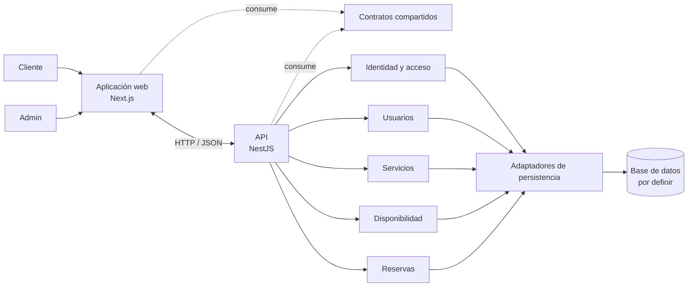

# Arquitectura propuesta

## Objetivo y alcance

Separar la experiencia de usuario, los casos de uso y las reglas del negocio, y el acceso a la persistencia para el MVP de AgendaApp. La arquitectura representa un monolito modular: una API central con módulos de dominio claros, sin añadir servicios distribuidos antes de necesitarlos.

La arquitectura describe responsabilidades y límites. El stack elegido (Next.js + NestJS con TypeScript) se detalla en el [README principal](README.md).

## Componentes

### Aplicación web

- Presenta las funciones disponibles según el rol del usuario.
- Permite al Cliente consultar servicios y disponibilidad, solicitar una reserva y revisar sus propias reservas.
- Permite al Admin gestionar servicios, disponibilidad y reservas.
- Se comunica con la API mediante contratos compartidos; no accede directamente a la persistencia.
- Las validaciones de interfaz ayudan al usuario, pero la API vuelve a validar toda solicitud.

### API de la aplicación

- Expone las operaciones que necesita la aplicación web.
- Autentica a los usuarios y aplica autorización según los roles Admin y Cliente.
- Coordina casos de uso y aplica las reglas del negocio.
- Comprueba la disponibilidad al procesar una solicitud de reserva, para evitar aceptar horarios que ya no estén libres.
- Es el único componente que accede a la persistencia.

La API se divide inicialmente en módulos:

- **Identidad y acceso:** autenticación y autorización.
- **Usuarios:** datos de cuenta y rol.
- **Servicios:** catálogo de servicios ofrecidos.
- **Disponibilidad:** consulta y gestión de horarios.
- **Reservas:** creación, consulta y gestión de reservas.

Cada módulo puede organizar controladores de entrada, casos de uso/servicios de aplicación, reglas del dominio y adaptadores de persistencia. Los controladores traducen HTTP a operaciones de aplicación; las reglas del negocio no dependen de la interfaz web. Las clases de dominio se incorporarán a partir de los casos de uso y el modelo de clases acordados, sin duplicarlas como tipos de transporte en el frontend.

### Persistencia

- Guarda usuarios y roles, servicios, disponibilidad y reservas.
- Mantiene las relaciones e integridad de los datos.
- El acceso queda detrás de adaptadores/repositorios internos de la API.
- La base de datos, el modelo físico y la herramienta de persistencia se definirán después.

### Contratos compartidos

- Publican los tipos y acuerdos de comunicación que necesitan la web y la API.
- Pueden incluir contratos de solicitudes y respuestas, roles y esquemas de validación compartidos.
- No contienen reglas del negocio, entidades internas ni acceso a datos.

## Diagrama de componentes



## Roles y permisos

- **Cliente:** consulta disponibilidad, solicita una reserva y consulta sus propias reservas.
- **Admin:** administra servicios y disponibilidad, y consulta y gestiona reservas.

La API debe comprobar permisos en cada operación. Ocultar una opción en la interfaz no protege una acción.

## Flujo básico de reserva

1. El Cliente selecciona un servicio y pide consultar horarios.
2. La web solicita disponibilidad a la API.
3. El módulo de disponibilidad consulta los datos y devuelve las opciones libres.
4. El Cliente elige un horario y envía la solicitud de reserva.
5. La API verifica identidad, permiso, formato y disponibilidad actual.
6. Si el horario sigue disponible, el módulo de reservas registra la solicitud y devuelve su estado. Si dejó de estar disponible, la API informa el conflicto y permite consultar otros horarios.
7. El Cliente consulta el estado de su reserva; el Admin puede verla y gestionarla según sus permisos.

## Scaffolding del monorepo

```text
agenda-app/
├─ apps/
│  ├─ web/                         # aplicación Next.js
│  │  └─ src/app/                  # rutas y presentación
│  └─ api/                         # aplicación NestJS
│     └─ src/
│        ├─ modules/
│        │  ├─ auth/
│        │  ├─ users/
│        │  ├─ services/
│        │  ├─ availability/
│        │  └─ reservations/
│        └─ health/                # endpoint técnico de salud
├─ packages/
│  └─ shared/                      # tipos y contratos públicos
├─ docs/
│  ├─ casos-de-uso/
│  └─ diagramas/
├─ package.json                    # workspaces y comandos comunes de npm
├─ .nvmrc                          # versión de Node.js para NVM
├─ tsconfig.base.json
├─ README.md                       # stack elegido y cómo iniciar
└─ README-ARQUITECTURA-PROPUESTA.md
```

## Límites de dependencias

- `apps/web` depende de los contratos compartidos y llama a la API; no conoce la base de datos.
- `apps/api` depende de los contratos públicos y contiene la lógica de aplicación y dominio.
- Los módulos de negocio usan adaptadores de persistencia internos; ningún otro componente accede directamente al almacenamiento.
- `packages/shared` es una frontera de contratos, no un lugar para acumular lógica del backend.
- `docs` conserva requisitos, casos de uso y diagramas para trazar las clases y reglas a implementar.

## Decisiones pendientes

- Definir autenticación, sesiones y recuperación de acceso.
- Acordar estados de reserva, cancelaciones y reglas de modificación.
- Elegir base de datos y estrategia de persistencia.
- Precisar si las reservas quedan confirmadas automáticamente o requieren confirmación del Admin.
- Derivar el modelo de clases definitivo desde los casos de uso y artefactos académicos del proyecto.
