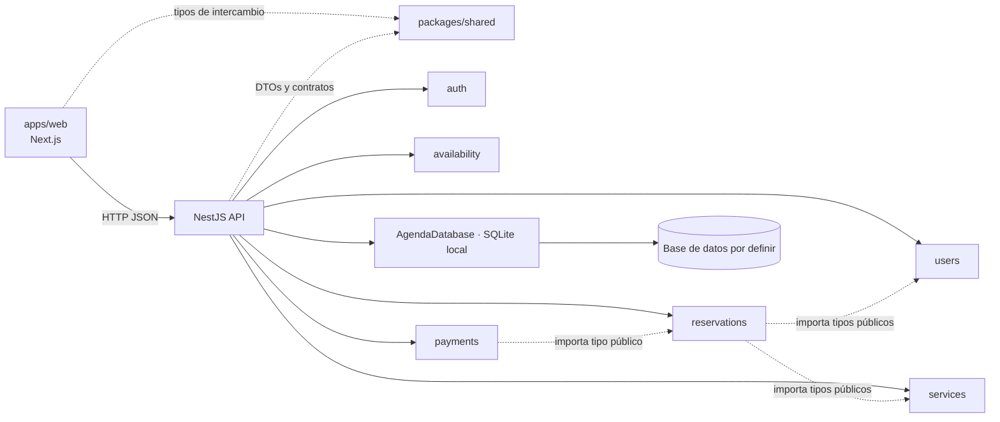

# Arquitectura de AgendaApp

## Enfoque

AgendaApp se organiza como un **monolito modular**: una aplicación web Next.js, una API NestJS y un paquete pequeño de contratos compartidos. La API es un solo proceso, dividido por capacidades del negocio. No hay microservicios. PP2-6 utiliza SQLite local, sin ORM; el motor definitivo de despliegue sigue pendiente.

La implementación actual incluye PP2-10 (autenticación local), PP2-6 (reserva guiada y jornadas laborales) y PP2-11 (gestión del catálogo). La persistencia parcial de CU09 se documenta en [PP2-6](casos-de-uso/PP2-6-reservar-turno.md) y la gestión del catálogo en [PP2-11](casos-de-uso/PP2-11-gestionar-catalogo-servicios.md). PP2-12 completa la presentación accesible de la selección única de servicio y se documenta en [PP2-12](casos-de-uso/PP2-12-seleccionar-servicio.md). Las clases del MODP no se consideran automáticamente materializadas por esta implementación; los perfiles completos y pagos permanecen pendientes.

## Componentes y límites

- **`apps/web` (Next.js):** presentación y experiencia de usuario. Sus componentes pueden validar entradas para ayudar al usuario, pero la API valida identidad, permisos y reglas del negocio.
- **`apps/api` (NestJS):** frontera HTTP, aplicación, dominio y persistencia local. Es el único componente que accederá a la base de datos.
- **`packages/shared`:** contratos de solicitudes/respuestas y tipos técnicos que cruzan la frontera HTTP. No contiene entidades del dominio ni reglas de negocio.
- **`docs`:** requisitos, casos de uso y diagramas que justifican las clases y responsabilidades.

En el modelo BCE, las Boundary de interfaz (`AutenticacionUI`, `ReservaTurnoUI`, `TurnosUI`) corresponden a Next. En Nest, los controladores HTTP reciben y responden solicitudes. Los controles de aplicación coordinan casos de uso; las entidades representan conceptos del dominio.

## Qué significa un módulo Nest

Un `@Module` de Nest configura un límite de dependencias: agrupa controladores y providers, e importa o exporta providers entre capacidades. Por ejemplo, `UsersModule` está declarado en `apps/api/src/modules/users/users.module.ts` y se importa desde `AppModule`.

`UsersModule` **no es una clase de negocio llamada `Users`**. Las clases de negocio son `Usuario`, `Cliente`, `Peluquero` y `Administrador`, ubicadas en `users/domain/`. Una entidad no tiene que aparecer en `providers`: los providers son objetos gestionados por Nest (controladores de aplicación, adaptadores y servicios técnicos); las entidades se crean como objetos del dominio cuando un caso de uso las necesita.

`AppModule` es la raíz de composición de Nest: registra los módulos funcionales. No contiene reglas de negocio.

## Responsabilidad de cada módulo

| Módulo | Clases/función dueña | Estado actual |
|---|---|---|
| `auth` | `AutenticacionControl`, sesiones, lista permitida y guards | Inicio, sesión actual y cierre de sesión implementados para `ADMIN` y `CLIENT`. |
| `users` | `Usuario`, `Cliente`, `Peluquero`, `Administrador` | Entidades modeladas; PersonalControl consulta personal precargado. Perfiles completos pendientes. |
| `services` | `Servicio` y catálogo | Entidad y persistencia; consulta de activos para reservas, ABM Admin y baja lógica con reactivación (PP2-11). |
| `availability` | Consulta de horarios disponibles | AgendaControl calcula horarios desde jornadas semanales configuradas por Admin, duración y ocupación persistida. |
| `reservations` | `Turno`, reserva, consulta y cambios de estado | ReservaTurnoControl registra Pendiente en SQLite, protege intervalos e idempotencia y devuelve recibos propios. Otras transiciones pendientes. |
| `payments` | `Pago` y cobros | Módulo Nest declarado en esta estructura; entidad modelada, sin flujo de cobro. |
| `health` | Estado técnico de la API | Endpoint `GET /api/v1/health`. |

Los módulos funcionales que todavía no exponen una función tienen una declaración mínima. No significa que sus casos de uso ya estén implementados. El rol `Peluquero` existe en el dominio, pero el acceso de ese rol no está habilitado en PP2-10.

## Dónde va cada clase

Cada clase tiene **un solo módulo propietario**, el que implementa sus reglas y mantiene sus cambios:

- `Usuario`, `Cliente`, `Peluquero`, `Administrador` → `apps/api/src/modules/users/domain/`.
- `Servicio` → `apps/api/src/modules/services/domain/`.
- `Turno` → `apps/api/src/modules/reservations/domain/`.
- `Pago` → `apps/api/src/modules/payments/domain/`.
- `AutenticacionControl` → `auth/application/`, como control de aplicación del inicio de sesión.

No se crean copias de `Usuario` o `Turno` en otros módulos, en Next o en `packages/shared`. Cuando otra clase de dominio necesita una clase dueña de otro módulo, la importa como tipo a través del punto público de ese módulo (`users/index.ts`, `services/index.ts`, `reservations/index.ts`). Los cambios y reglas siguen siendo responsabilidad del módulo dueño. Evitamos dependencias circulares; si aparecen, revisamos la asociación o introducimos un contrato explícito.

Las subclases de usuario reutilizan los datos comunes definidos en `Usuario`. Las asociaciones de `Turno` y `Pago` conservan las clases del modelo; no se duplican sus atributos para representarlas. Los tipos de `packages/shared` describen el formato de intercambio HTTP y pueden diferir de las entidades internas.

La lista permitida de PP2-10 solo tiene `email`, `role` y `passwordHash`, y funciona como adaptador local de desarrollo. En esta iteración `AutenticacionControl` depende directamente de `UserAllowlistService`; al incorporar persistencia, se extraerá un puerto de aplicación para desacoplar el caso de uso del adaptador. La sesión transporta una identidad autenticada mínima de `packages/shared`, todavía no una instancia completa de `Usuario`, porque el dominio también define `id`, `nombre` y `telefono`. La integración de cuentas con las entidades de usuario queda pendiente de persistencia y datos de perfil.

## Estructura y convención para crecer

```text
apps/api/src/
├─ app.module.ts                  # composición de módulos
├─ health/                        # endpoint técnico
└─ modules/
   ├─ auth/
   │  ├─ auth.module.ts
   │  ├─ auth.controller.ts             # frontera HTTP
   │  ├─ application/
   │  │  └─ autenticacion.control.ts    # coordinación del caso de uso
   │  ├─ infrastructure/
   │  │  ├─ session.service.ts          # cookie y sesión firmada
   │  │  └─ user-allowlist.service.ts   # cuentas locales de prueba
   │  ├─ roles.guard.ts                 # autorización HTTP
   │  └─ session-auth.guard.ts
   ├─ users/
   │  ├─ users.module.ts          # módulo Nest, no entidad Users
   │  ├─ index.ts                 # API pública para otros módulos
   │  └─ domain/                  # clases de negocio propietarias
   ├─ services/
   │  ├─ services.module.ts
   │  ├─ index.ts
   │  └─ domain/
   ├─ availability/
   ├─ reservations/
   │  ├─ reservations.module.ts
   │  ├─ index.ts
   │  └─ domain/
   └─ payments/
      ├─ payments.module.ts
      ├─ index.ts
      └─ domain/
```

Dentro de cada módulo, agregamos carpetas solo al implementar esa responsabilidad:

- `domain/`: entidades y reglas del negocio propias del módulo.
- `application/`: controles/servicios que coordinan un caso de uso.
- `infrastructure/`: repositorios, ORM y adaptadores externos.
- controladores HTTP en el módulo (o en `http/` si su cantidad lo justifica).

No se crean clases por rutina: derivamos entidades y operaciones de los casos de uso, requisitos y diagramas acordados. DTOs, formularios y modelos de pantalla no son entidades de dominio.

## Dependencias



Reglas de dependencia:

1. La web se comunica con la API por HTTP y consume contratos públicos; no importa clases de `apps/api`.
2. Cada módulo escribe solo sus tablas e importa las interfaces públicas de los demás módulos. Para calcular disponibilidad, agenda consume la proyección de lectura `ocupacion_agenda` que publica la infraestructura, sin datos personales de clientes.
3. Un módulo solo comparte sus clases públicas intencionales mediante su `index.ts`; evita los imports directos a `otro-modulo/domain/archivo`.
4. Las dependencias entre módulos avanzan hacia interfaces públicas y no forman ciclos. AgendaDatabase provee el adaptador local. La extracción de puertos/repositorios por módulo queda documentada para cambiar de motor.
5. No trasladamos entidades a `packages/shared` para reutilizarlas entre frontend y backend: allí compartimos formatos de comunicación, no el modelo interno.

## Próximas decisiones

- Definir transiciones y permisos de estados, cancelaciones y rechazos de turnos.
- Extender la disponibilidad a excepciones y ausencias; PP2-6 ya calcula duración completa y protege reservas simultáneas.
- Elegir el motor definitivo de despliegue y resolver cómo se materializa `Usuario` desde las cuentas autenticadas; SQLite local ya cubre CU09.
- Implementar los controles del catálogo completo de casos de uso conforme al alcance priorizado.
- Confirmar exclusividad/coexistencia de roles, origen del rating y reglas de pago.

Las clases y decisiones de dominio deben mantenerse trazadas al Modelo de Diseño, requisitos, casos de uso y diagramas fuente de AgendaApp que se conservan en el espacio de trabajo PP2.

## Persistencia local incorporada en PP2-6

AgendaDatabase es el adaptador compartido de SQLite. Los módulos conservan la propiedad del catálogo, personal, agenda y reserva; publican controles por sus index.ts y no duplican entidades en Next/shared. Los contratos de intercambio están en packages/shared. La escritura de la reserva, vinculación técnica del Cliente y auditoría forman una transacción. La interfaz Next nunca recibe acceso a SQLite. El detalle del esquema parcial, sus compromisos y decisiones pendientes están en [PP2-6](casos-de-uso/PP2-6-reservar-turno.md).
